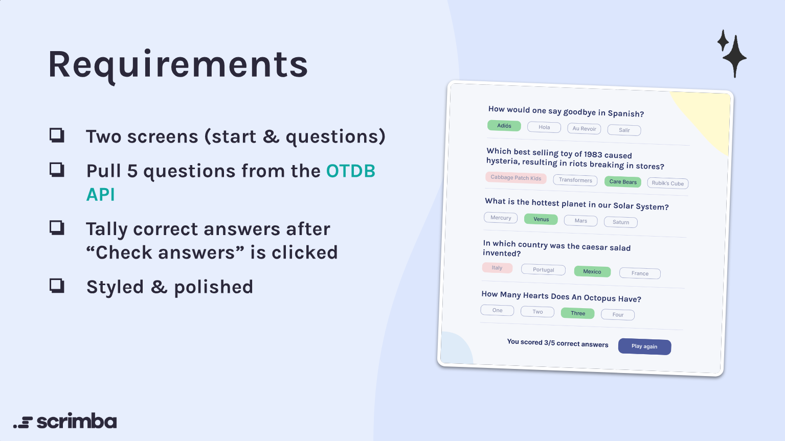

# 🧩 Quizzical
## Project for Scrimba's Learn React Course
This project is a quiz game built with React. It fetches trivia questions from the Open Trivia Database API and allows users to test their knowledge across various categories and difficulty levels.

## How to Play
1. Click start a quiz.
2. Answer the 5 questions by selecting only one of the options.
3. Click "Check answers" to see your score and the correct answers.
4. Click "Play again" to start a new quiz.




🔗 Design in Figma: [Link](https://www.figma.com/design/E9S5iPcm10f0RIHK8mCqKL/Quizzical-App?node-id=0-1&p=f&t=0MskgYslEu27OHJx-0)


---

## 🌍 Demo

- Live: https://mirkobechini.github.io/quizzical/

---

## 🛠️ Tech Stack

- **React**: User Interface
- **CSS**: Styling
- **Vite**: Build tool
- **Figma**: Design
- **OTDB API**: Online Trivia Database API
- **html-entities**: Decode HTML entities
- **axios**: Fetch data from API
- **clsx**: Conditional classNames

---

## 🚀 Quick Start

### Requirements

Before you begin, ensure you have installed:

- Node.js (v18+)
- npm (included with Node.js)

### Installation

```bash
# Clone the repository
git clone https://github.com/mirkobechini/quizzical.git

# Entra nella cartella del progetto
cd quizzical

# Installa le dipendenze
npm install
```

### Start

```bash
npm run dev
```

Open your browser at `http://localhost:5173`.

---

## 📂 Project Structure

```text
.
|-- src/
|-- public/
|-- readme-images/
|-- README.md
|-- package.json
```

---

## 🗺️ Roadmap

- [x] First page raw design
- [x] Fetch questions from API
- [x] Question page raw design
- [x] Display questions and answers
- [x] Check answers
- [x] Store corrected answers
- [x] Display results page raw design
- [x] Add new game functionality
- [x] CSS styling
- [x] Manage randomized answers order after checking answers
- [x] Decode HTML entities in questions and answers
- [x] Add loading state
- [x] Add Background
- [x] a11y
- [x] Deploy

---

## 🤝 Contributing

Contributions improve the project. To contribute:

1. Fork the repository
2. Create a branch: `git checkout -b feature/FeatureName`
3. Commit your changes: `git commit -m "Add FeatureName"`
4. Push the branch: `git push origin feature/FeatureName`
5. Open a Pull Request

---

## 📄 License

Distributed under the MIT License. See the `LICENSE` file for details.

---

## 📧 Contact

Mirko Bechini - LinkedIn: (https://www.linkedin.com/in/mirko-bechini-892202252) - mirkobechini@gmail.com

Project link: https://github.com/mirkobechini/quizzical
